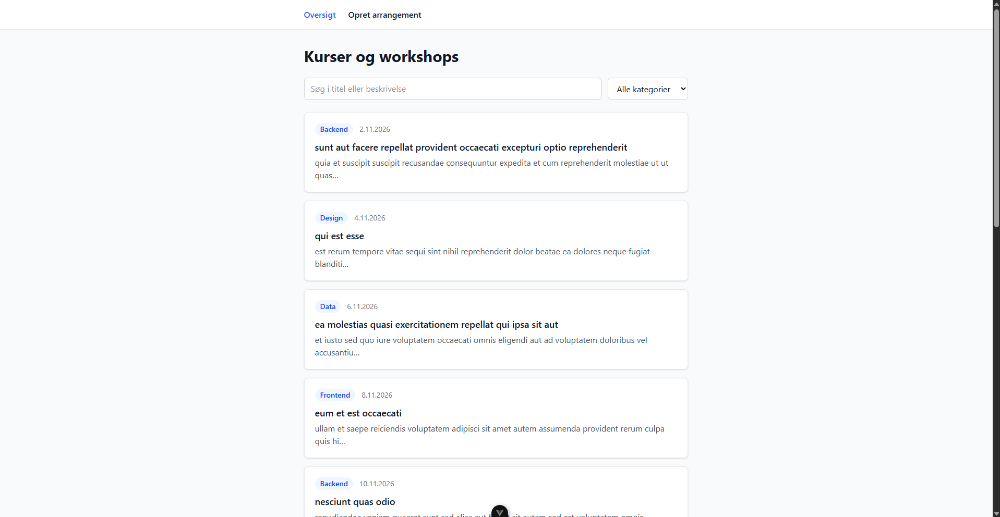
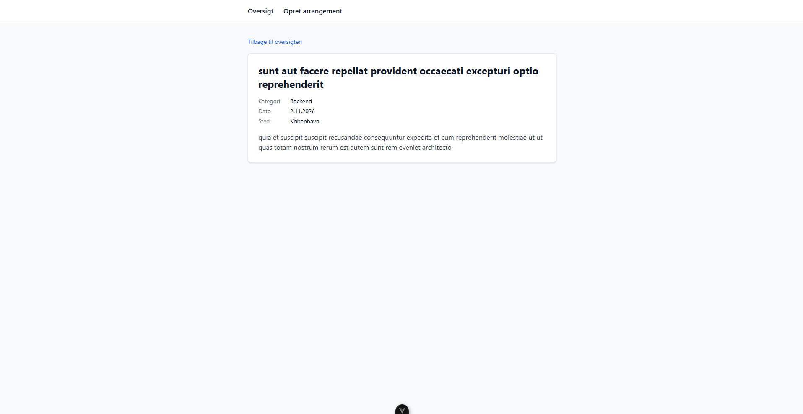

# Kursusoversigt

## Skærmbilleder

## Komponenter

**EventFilters**
Søgefeltet og kategori-dropdownen. Når man skriver eller vælger en kategori, sender den værdien op til oversigten med emit.

**EventForm**
Formularen til at oprette et arrangement. Den tjekker at titel, kategori og dato er udfyldt og viser en fejlbesked hvis noget mangler. Ellers sender den dataene videre, så arrangementet bliver tilføjet.

## Søgning og filtrering

Søgningen og kategorien er gemt i ref's. Listen der vises er en computed, som filtrerer arrangementerne ud fra dem, så den opdaterer sig automatisk når man skriver eller skifter kategori.

## Vue Router

Der er tre routes: `/` er oversigten, `/events/:id` er detaljesiden og `/create` er formularen. Siderne bliver vist i `<RouterView />` i App.vue. Man navigerer med RouterLink, og detaljesiden læser id'et fra URL'en for at finde arrangementet.

## HTTP-kald

Når appen starter, henter den posts fra JSONPlaceholder med fetch. Title og body bruges som titel og beskrivelse, og kategori og dato bliver sat lokalt. Mens den henter, står der "Henter arrangementer…". Hvis kaldet fejler, vises en fejlbesked med en "Prøv igen"-knap.
